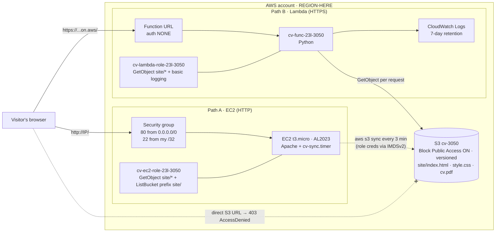

# Host Your CV on AWS — 23l-3050

| | |
|---|---|
| Roll number | 23l-3050 |
| Region | REGION-HERE |
| EC2 site | http://EC2-PUBLIC-IP/ |
| Lambda site | https://XXXXXXXX.lambda-url.REGION.on.aws/ |
| S3 bucket | cv-3050 (private) |

## 1. Architecture



**Path A (EC2):** the browser connects to the instance's public IP on port 80, the security group lets it in, and Apache returns files from `/var/www/html` that `sync-cv.sh` copied from S3 (using the instance role) and stamped with `EC2 <instance-id>`. The request itself never touches S3; the copy is refreshed every 3 minutes by a systemd timer.

**Path B (Lambda):** the browser calls the HTTPS function URL, the resource-based policy lets anyone invoke it, and the function reads the requested object from S3 with its execution role, replaces the footer with `Lambda <function-name>` and returns it (the PDF base64-encoded). Any other path gets a 404 page.

## 2. Access denied from the instance (section 4)

Run on the instance (Instance Connect / SSH):

```text
PASTE OUTPUT HERE, e.g.
[ec2-user@ip-172-31-x-x ~]$ aws s3 rm s3://cv-3050/site/style.css
delete failed: s3://cv-3050/site/style.css An error occurred (AccessDenied) when calling the DeleteObject operation: User: arn:aws:sts::ACCOUNT:assumed-role/cv-ec2-role-23l-3050/i-0abc... is not authorized to perform: s3:DeleteObject ...
[ec2-user@ip-172-31-x-x ~]$ aws s3 cp /etc/hostname s3://cv-3050/site/style.css
upload failed: ../../etc/hostname to s3://cv-3050/site/style.css An error occurred (AccessDenied) when calling the PutObject operation: ...
```

## 3. Last 10 lines of /var/log/cv-sync.log

```text
PASTE OUTPUT OF:  sudo tail -n 10 /var/log/cv-sync.log
```

## 4. Repository layout

```
README.md              this file
collect-evidence.sh    evidence script (usage: ./collect-evidence.sh <bucket> <ec2-address> <lambda-address>)
evidence.txt           output of my own run
site/                  index.html, style.css, cv.pdf  (uploaded to s3://cv-3050/site/)
ec2/user-data.sh       first-boot script: Apache, sync script, systemd timer
ec2/sync-cv.sh         S3 -> web root sync + footer stamping + log line
lambda/lambda_function.py   Lambda handler (BUCKET and PREFIX from environment)
iam/                   trust + permission policy JSON for both roles
```

## 5. Written answers

> Draft answers — rewrite them in your own words before submitting.

**1. Why roles instead of access keys? What if keys were in the user data?**
A role gives the instance and the function short-lived credentials that AWS issues and rotates automatically, so there is no long-term secret to store, copy or leak. Access keys never expire on their own and work from anywhere on the Internet. User data is not secret: anyone with `ec2:DescribeInstanceAttribute` can read it, and any process on the instance can fetch it from the metadata service. Because this repository is public, keys in `user-data.sh` would be scraped by bots within minutes and could be used to run up a bill or read and delete data until someone noticed and deactivated them.

**2. Someone opens the S3 address of index.html. What do they see and why?**
They get an HTTP 403 with an XML `AccessDenied` error instead of the page. Objects in S3 are private by default, the bucket has no bucket policy or ACL that grants anything to everyone, and all four Block Public Access settings are on, which makes S3 ignore public ACLs and refuse public bucket policies even if one were added by mistake. The browser's request is anonymous, so no policy allows it.

**3. The permission on the function URL that lets anyone call it. Why OK for the function but not the bucket?**
It is a resource-based policy statement on the function with Principal `*` that allows `lambda:InvokeFunctionUrl` when `lambda:FunctionUrlAuthType` is `NONE`, plus (since October 2025) `lambda:InvokeFunction` only when invoked via the function URL. It means anyone on the Internet may trigger the function through its URL, but they only get what my code decides to return. The function serves exactly three fixed files, cannot list, write or delete, and its own role can only read `site/*`. Making the bucket public instead would expose every object and version directly, with no code in between to limit what is served, which is the classic cause of S3 data leaks.

**4. Compare the paths: cost with no visitors, and with 100× traffic.**
With no visitors the EC2 path still costs money every hour: the running instance, its EBS volume and its public IPv4 address (Free Tier only offsets this), while the Lambda path costs essentially nothing because Lambda bills per request and duration, leaving only a few cents of S3 storage. If traffic grows 100×, the single t3.micro becomes the bottleneck (CPU credits, bandwidth, one point of failure) and I would have to scale it myself with a bigger instance or an Auto Scaling group behind a load balancer. Lambda scales out automatically up to the account concurrency limit, and its cost rises linearly with requests, including one S3 GET per request. A burst of abusive traffic is therefore an availability problem on EC2 and a cost problem on Lambda.

**5. You delete the EC2 instance. What do you lose and what do you keep?**
I lose the instance, its root EBS volume with the web root copy, `/var/log/cv-sync.log` and the systemd timer, and its public IP address, so the EC2 address stops working and a new instance would get a different IP. I keep everything that matters: the CV files and all their versions in S3, the IAM role and instance profile, the security group, and `user-data.sh` and `sync-cv.sh` in this repository, so a new instance can be launched and rebuilt automatically. The Lambda site keeps working the whole time because it does not depend on the instance.

## 6. Sources

- AWS documentation: S3 Block Public Access, IAM policy elements and `s3:prefix` condition key, EC2 instance metadata (IMDSv2), Lambda function URLs (access control), CloudWatch Logs retention.
- Course material for Lab 7.
- REPLACE: say here which parts you adapted and from where (including any AI assistance, as required by your instructor's rule).
